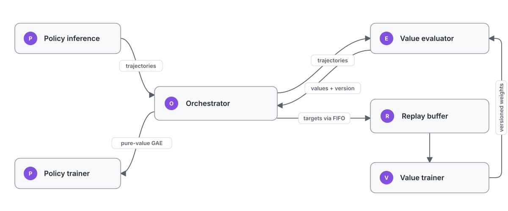

# Prime Values

[**arXiv Paper**](https://arxiv.org/abs/2608.16739) · [**Project Page**](https://privileged-value-functions.github.io/)

```bibtex
@misc{venkatraman2026lecritiqueprivilegedvalue,
      title={Le Critique: Privileged Value Functions for LLM Reinforcement Learning},
      author={Siddarth Venkatraman and Matthieu Dinot and Laurence Aitchison},
      year={2026},
      eprint={2608.16739},
      archivePrefix={arXiv},
      primaryClass={cs.LG},
      url={https://arxiv.org/abs/2608.16739},
}
```

Prime Values extends [PRIME-RL](https://github.com/PrimeIntellect-ai/prime-rl)
with asynchronous value functions and rollout replay. It keeps critic learning
outside the policy trainer: a value evaluator scores each rollout's causal
states, the orchestrator turns those predictions into per-token GAE and value
targets, and the policy receives the pure value advantage without owning any
critic model or loss.

Completed rollouts enter a bounded, nonblocking queue and a rollout-granular
replay buffer. The value trainer samples critic batches independently of policy
updates, publishes monotonically versioned weights, and lets the evaluator
adopt those weights without coupling critic progress to policy versions. Value
evaluation can run on dedicated GPUs for independent throughput or queue on the
value trainer's GPUs when a smaller deployment matters more.

Start with the [supported native training profile](configs/native/README.md) for current reverse-text and cached RG launch configs, with or without a value function. This branch does not yet replace the full historical environment catalog; its explicit compatibility inventory and frozen references are linked there.

See [Value Functions](docs/value-functions.md) for topology, replay semantics,
configuration, and monitoring.

### Architecture at a glance

<p align="center">
  
</p>

<p align="center">
  
</p>

---

<p align="center">
</p>

<p align="center">
  
  
</p>

---

<h3 align="center">
PRIME-RL: Async RL Training at Scale
</h3>

---

</br>
<p align="center">
  <a href="https://github.com/HyperPotatoNeo/prime-values/actions/workflows/style.yaml">
    
  </a>
  <a href="https://github.com/HyperPotatoNeo/prime-values/actions/workflows/cpu_tests.yaml">
    
  </a>
  <a href="https://github.com/HyperPotatoNeo/prime-values/actions/workflows/gpu_tests.yaml">
    
  </a>
</p>

## Upstream architecture overview

The following architecture/model catalog describes inherited PRIME-RL capabilities. The supported end-to-end profile on this branch is native reverse-text and cached RG with the documented policy/value paths; the catalog is not a claim of validation for every model, media type, deployment or environment.

PRIME-RL is a framework for large-scale reinforcement learning. It is designed to be easy to use and hackable, yet capable of scaling to 1000+ GPUs. Here is what we think sets it apart:

1. Fully asynchronous RL for high-throughput agentic training at scale.
2. Performant: built to train 1T+ MoE models on 1000+ GPUs with [FSDP2](https://docs.pytorch.org/tutorials/intermediate/FSDP_tutorial.html) for training and [vLLM](https://github.com/vllm-project/vllm) for inference, with FP8 inference, PD disaggregation, EP and CP parallelism, and more.
3. Native integration with [`verifiers`](https://github.com/PrimeIntellect-ai/verifiers) environments through the [Environments Hub](https://app.primeintellect.ai/dashboard/environments?ex_sort=most_stars), including built-in support for SWE and agentic environments.
4. End-to-end post-training: SFT, RL training, and evals.
5. Multi-node deployment with Slurm and Kubernetes support.
6. Multimodal support for VLMs such as Qwen3-VL.
7. Hackable, modular, and extensible by design.
8. One-line SLURM deployment for frontier models — e.g. [`GLM-5` FP8 with P/D disaggregation, the `llm-d` router, and Mooncake KV offload](examples/glm5_llmd/README.md).


## Models support


The trainer works with both Hugging Face and Prime custom `ModelForCausalLM` out of the box. For selected families (especially large MoE) we also ship highly optimized training code under `src/prime_rl/trainer/models/`, including expert parallelism (EP) for MoE layers and context parallelism (CP) for long sequences (see the table), and additional kernels like [quack-kernels](https://github.com/quack-kernels/quack-kernels).

With `[model] impl = "auto"` (the default), the trainer selects that custom stack when the Hugging Face config type is registered.

| Family | Example IDs | MoE | EP | CP |
|--------|-------------|-----|----|-----|
| GLM-5 (`glm_moe_dsa`) | `zai-org/GLM-5`, `zai-org/GLM-5-FP8` | yes | ✅ | ✅ |
| Qwen3 MoE (`qwen3_moe`) | `Qwen/Qwen3-30B-A3B`, … | yes | ✅ | ✅ |
| Qwen3.5 MoE (`qwen3_5_moe`) | `Qwen/Qwen3.5-35B-A3B`, … | yes | ✅ | ✅ |
| Qwen3 / Qwen3.5 VLMs | see [advanced.md](docs/advanced.md#vision-language-models) (`qwen3_vl`, `qwen3_5`, `qwen3_5_moe`) | MoE only on MoE VLMs | MoE only | ✅ |
| Poolside Laguna (`laguna`) | `poolside/Laguna-XS.2` | yes | ✅ | ✅ |
| MiniMax M2 (`minimax_m2`) | `MiniMax/MiniMax-M2` | yes | ✅ | ✅ |
| Nemotron H (`nemotron_h`) | `nvidia/Nemotron-3-Nano-30B-A3B`, `nvidia/Nemotron-3-Super-120B-A12B`, … | yes | ✅ | ✅ |
| Trinity (`afmoe`) | `arcee-ai/Trinity-Mini`, … | yes | ✅ | ✅ |
| GLM-4 · GLM-4.5 MoE · INTELLECT-3 (`glm4_moe`) | `THUDM/GLM-4-9B-0414`, `zai-org/GLM-4.5-Air`, `zai-org/GLM-4.5`, `PrimeIntellect/INTELLECT-3`, … | yes | ✅ | ✅ |
| GPT-OSS (HF, MoE) | `openai/gpt-oss-20b`, `openai/gpt-oss-120b` | yes |  ✅ | ✅ |
| Other HF causal LMs | Qwen3 dense, Mistral, … (`impl = "hf"`) | varies | ❌ | ✅ |


## Setup

> Use Linux, Python 3.12, an NVIDIA GPU/driver compatible with the locked CUDA 13 stack, and enough device/host memory for the selected roles. See [native examples](configs/native/README.md) for current resource and acceptance scope. Report problems in this repository's [issues](https://github.com/HyperPotatoNeo/prime-values/issues).

### Prerequisites

Currently, you **need at least one NVIDIA GPU to use PRIME-RL**. If you don't already have access to one, we recommend our [compute platform](https://app.primeintellect.ai) for everything from renting on-demand single GPUs for developing, debugging and small ablations, to [reserving 1000+ GPU clusters](https://app.primeintellect.ai/dashboard/quotes) for production-scale training.

### Quick Setup

Set up PRIME-RL in a single command.

```bash
curl -sSL https://raw.githubusercontent.com/HyperPotatoNeo/prime-values/main/scripts/install.sh | bash
```

<details>
<summary>
Manual Setup
</summary>
<br>

1. Clone the repository

```bash
git clone https://github.com/HyperPotatoNeo/prime-values.git
cd prime-values
```

2. Initialize submodules

```bash
git submodule update --init --recursive -- deps/verifiers deps/renderers deps/research-environments deps/pydantic-config
```

3. Install [uv](https://docs.astral.sh/uv/)

```bash
curl -LsSf https://astral.sh/uv/install.sh | sh
source $HOME/.local/bin/env
```

4. Install dependencies from the lock file

```bash
uv sync --all-extras --locked
```

The lock selects platform-specific attention wheels. Do not replace them with an unpinned source build. This native profile's recorded full runtime acceptance is Linux x86_64; other hardware requires its own validation.

</details>

<details>
<summary>
Validate your environment setup
</summary>
<br>

1. Check that the environment uses Python 3.12

```bash
uv run python -V
```

2. Check that `flash-attn` is installed

```bash
uv run python -c "import flash_attn"
```

3. Resolve the current native policy configuration without launching workers

```bash
uv run rl @ configs/native/reverse_text_policy.toml --dry-run --output-dir outputs/native-check
```

4. On a suitably provisioned machine, launch the supported native smoke run

```bash
WANDB_MODE=offline uv run rl @ configs/native/reverse_text_policy.toml --output-dir outputs/native-smoke
```

The authored Qwen4B policy example requests two GPUs; the value example requests four. These role counts do not establish memory fit on every GPU. Consult [native examples](configs/native/README.md) and select a smaller model when needed.

</details>

### Additional Setup

1. If you want to log your runs to [W&B](https://wandb.ai), log in

```bash
uv run wandb login
# Or set `export WANDB_API_KEY=...`
```

2. If you require gated/ private models or datasets from [HuggingFace](https://huggingface.co), log in

```bash
uv run hf auth login
# Or set `export HF_TOKEN=...`
```

## Training Examples
The [`examples`](examples) directory preserves the upstream/historical catalog. Its RL configurations are not all executable on this native profile. Use [configs/native](configs/native/README.md) for current launch examples and the [compatibility inventory](experiments/dependency-migration/config-compatibility.json) for explicit entrypoint and rejection contracts. The descriptions below document the historical examples, not validation of every model or environment on this branch.

### Basic Training: 1 to 8 GPUs

Follow this guide to learn the basics of Prime-RL. You can train your own models on 1 to 8 GPUs. Ideal for getting started and exploring the capabilities of the framework. These guides cover most use cases -- single-turn, multi-turn, tool calling, etc. -- on toy environments and small models.

1. [**Reverse Text**](examples/reverse_text/README.md): Train `Qwen3-0.6B` to reverse a small chunk of text. Demonstrates tiny-scale single-turn SFT and RL training. Can be trained on a single consumer GPU in a few minutes, and is ideal for getting started.
2. [**Wordle**](examples/wordle/README.md): Train `Qwen3-1.7B` to play Wordle. A fun example of multi-turn SFT and RL training. Can be trained on a 2-4 H100 GPUs in a few hours. Ideal for exploring the multi-turn training capabilities of the framework.
3. [**Alphabet Sort**](examples/alphabet_sort/README.md): Train `Qwen3-4B-Instruct-2507` to sort names alphabetically. Demonstrates multi-turn RL training via LoRA without SFT warmup. Can be trained on a single H100 GPU in just over an hour. Ideal for exploring LoRA-based training.
4. [**Wiki Search**](examples/wiki_search/README.md): Train `Qwen3-4B-Instruct-2507` to answer trivia questions by searching through a Wikipedia. Demonstrates multi-turn with web search tool use.
5. [**Hendrycks Sanity**](examples/hendrycks_sanity/README.md): Run a sanity check experiment on `DeepSeek-R1-Distill-Qwen-1.5B` using a filtered subset of MATH where the model already partially solves 20-80% of problems. Useful for algorithm ablations.

### Advanced Training: 32 - 2048 GPUs:

Follow this guide to train large models on hard reasoning and agentic / swe environments.
These guides are designed to be run from a Slurm cluster but can also be adapted to k8s deployments.

1. [**Qwen 3 30B - A3B Math**](examples/qwen30b_math/README.md): Train `Qwen3-30B-A3B` to solve hard math problems.
2. [**Qwen 3 30B - A3B SWE**](examples/qwen30b_swe/README.md): Train `Qwen3-30B-A3B` to solve hard SWE problems.
3. [**Intellect-3.1**](examples/Intellect-3.1/README.md): Reproduce our `INTELLECT-3.1` training run.
4. [**MiniMax-M2.5 SWE**](examples/minimax_m2.5_swe/README.md): Train `MiniMax-M2.5` on agentic SWE tasks.
5. [**High-throughput GLM-5**](examples/glm5_pd_disag/README.md): Train `GLM-5` with PD disaggregation and FP8 inference on SWE.
6. [**High-throughput GLM-5 (llm-d)**](examples/glm5_llmd/README.md): One-line SLURM deployment for `GLM-5` FP8 with P/D disaggregation, the `llm-d` router, and Mooncake KV offload — the faster way to run `GLM-5`.

## Docs

Check out the [docs](docs) directory for in-depth guides on how to use PRIME-RL.

- [**Overview**](docs/overview.md) - Architecture, install, and a copy-pasteable end-to-end RL run
- [**Configuration**](docs/configuration.md) - TOML composition, CLI overrides, env vars, validation
- [**Training**](docs/training.md) - RL, SFT, evals, checkpointing, observability, rules of thumb
- [**Value Functions**](docs/value-functions.md) - Async critic topology, GAE targets, baselines, warmup, and checkpoints
- [**Scaling**](docs/scaling.md) - Single-GPU through multi-node, FSDP/EP/CP, SLURM, benchmarking
- [**Algorithms**](docs/algorithms.md) - Async/off-policy training, the AIPO loss, advantage and filter plugins, trajectory merging
- [**Advanced**](docs/advanced.md) - Custom modeling, multimodal training, LoRA, multi-tenant training
- [**Development**](docs/development.md) - Test suite, pre-commit hooks, adding a new model

## Contributing

We warmly welcome community contributions! We use [issues](https://github.com/HyperPotatoNeo/prime-values/issues) to track bugs, feature requests, and share our internal roadmap. If you encounter bugs, have pain points during development, or have ideas for new features, please open an issue.

Contributions are welcome via PR. Please follow these guidelines:
1. Install the [pre-commit hooks](#pre-commit-hooks) to ensure your code is formatted correctly.
2. Please keep your PR in "Draft" until it is ready for review.
3. If your PR resolves an issue, please link the issue in the PR description
4. If you can, try running the [test suite](#tests) locally to ensure your changes are working as expected.

### Pre-Commit Hooks

Please install the [pre-commit](https://pre-commit.com) hooks to ensure your code is formatted correctly.

```bash
uv run pre-commit install
```

### Tests

```bash
uv run pytest tests/unit -v -m "not gpu"                     # CPU unit suite
uv run pytest tests/unit -v -m gpu                           # GPU unit suite
uv run pytest tests/integration/test_native_profile.py -vvs  # current native lifecycle
```

See [Development](docs/development.md) for self-hosted GPU CI setup and the explicitly pinned workflow for preserved scenario tests.

## License

This project is licensed under the Apache 2.0 license, as found in the [License](LICENSE) file.

## Upstream PRIME-RL Citation

Prime Values extends PRIME-RL. To cite the upstream project, use:

```tex
@misc{primeintellect2025prime-rl,
  author = {Prime Intellect},
  title = {PRIME-RL},
  url = {https://github.com/PrimeIntellect-ai/prime-rl},
  year = {2025}
}
```
